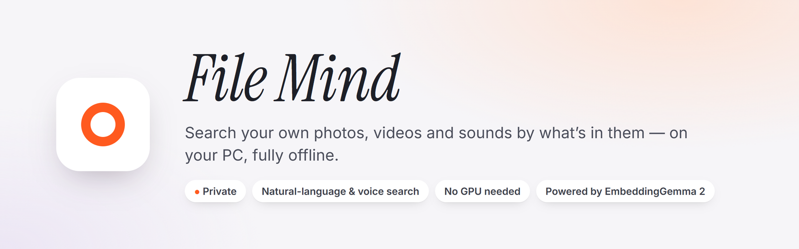
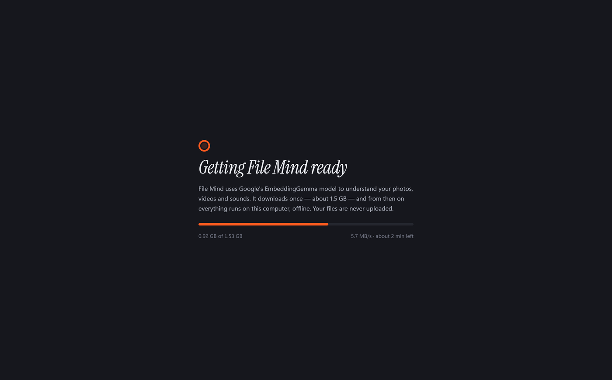

<p align="center"></p>

<h3 align="center">Find any photo, video or sound by describing it.<br>Runs entirely on your computer. No account, no cloud, no uploads.</h3>

<p align="center">
  <a href="https://github.com/tanzim5/filemind/releases/latest"></a>
  
  
  <a href="https://github.com/tanzim5/filemind/stargazers"></a>
</p>

<p align="center">
  <a href="https://github.com/tanzim5/filemind/releases/latest"><b>⬇ Download</b></a> &nbsp;·&nbsp;
  <a href="#features">Features</a> &nbsp;·&nbsp;
  <a href="#get-started">Get started</a> &nbsp;·&nbsp;
  <a href="#privacy">Privacy</a> &nbsp;·&nbsp;
  <a href="#run-from-source">Run from source</a> &nbsp;·&nbsp;
  <a href="https://x.com/tanzim31">@tanzim31</a>
</p>


File Mind reads a folder — Downloads, Pictures, a project drive — and understands **what is in** your photos, videos
and sounds using Google's [EmbeddingGemma 2](https://huggingface.co/google/embeddinggemma-2), a multimodal AI model
that runs on your own machine. Type what you remember ("red logo on black", "a man running at night") and it finds it.

## Features

### 🔎 Find anything
- **Search in plain language.** Stack several searches as tags to narrow down.
- **Search by voice.** Your voice stays on your computer. In the main window the recording itself is understood by the model; the quick-search launcher turns it into text with a local Whisper model (downloaded on first use) and stops listening when you pause. Settings can switch the launcher to Windows speech recognition instead, which shows words as you speak but may send audio to Microsoft when Windows' *Online speech recognition* setting is on.
- **Search with a reference.** Open any image, video or audio file and choose *Search with this file*, optionally adding words.
- **Find by details.** "4K videos of motorcycles", "vertical clips under 30 seconds", "images larger than 20 MB": media details become exact filters, the rest searches by meaning.
- **Find moments.** Search inside videos and sounds and open the result at the matching time.
- **More like this.** Keep following similar files, endlessly.
- **Automatic tags and colours** on every file. Filter by colour, type, source tool, date or size.
- **Quick search from anywhere.** Press **Ctrl+Shift+Space** for a launcher with results, a preview and file details.
- **Favourites and your own tags.** Star files, make coloured tags, and filter by them.

### 🧭 Explore your library
- **Discover** visual themes (architecture, products, illustrations…) or start from a suggested question.
- **Spaces.** Group files into collections. *Live* spaces keep matching files added later; *snapshots* stay fixed. **Auto-group** suggests named collections for you to review.
- **Review duplicates**: byte-identical copies and visually similar matches. Nothing is deleted for you.

### 🖱️ Work with your files
- **Drag originals into other apps** (Windows desktop): Photoshop, After Effects, Explorer and more. Drag a tile, the viewer's image or video, or the **Drag file** handle. Select several tiles to drag them together.
- **Copy a video frame** as a PNG straight from the viewer.
- **Export.** Save part of a video or sound as its own clip (mark the start with **I** and the end with **O**), turn files into MP4, WebM, GIF, MP3, WAV, JPG, PNG or WebP, shrink them to fit under a size, pull the sound out of a video, or make a contact sheet. Exports are always new files; the original is never changed. Select several files in the Library to export them together.
- **Audio playback and transcripts**: play and scrub a waveform right on its tile, then transcribe speech on your device in the detected language.
- **Previews for documents too**: PDFs show their first page, text, Markdown and Word files show a text card, and each opens in a viewer.
- **File actions**: copy or move the original, or send it to the system Trash. Copy and move never overwrite.
- **Preview renames** before anything on disk changes; commits can be undone.

### 🎨 Make it yours
- Four themes (Midnight, Graphite, Black and Light), six accent colours, a transparency slider, four gallery layouts (masonry, rows, contact sheet, storyboard) and tile size.
- File Mind stays in the notification area after you close the window so the quick-search shortcut keeps working. You can turn that off in Settings.


## Get started

Nothing to install: Python, ffmpeg and everything else are inside the download. The first launch fetches the AI model once; after that File Mind works fully offline.

| Your computer | Download | First launch also downloads |
|---|---|---|
| **Windows 10/11** (64-bit) | `FileMind-Windows.zip`: one app for every PC; on first run it picks CPU or NVIDIA PyTorch automatically | AI model (~1.5 GB), plus GPU support (~2.8 GB) on NVIDIA cards |

**Quick search anywhere:** press **Ctrl+Shift+Space** for the Raycast-style launcher. Change the shortcut in Settings.

**Keyboard:** in the viewer, **Space** plays or pauses, **Left/Right** skip 5 seconds (or step between pictures), **Ctrl+Left/Right** go to the previous or next file, **Up/Down** change the volume, **M** mutes, **[** and **]** change the speed, **,** and **.** step one frame, **I** and **O** mark a clip, **E** exports, **F** fills the screen and **Esc** goes back. In the Library, **Ctrl+C** copies the selected files, **Ctrl+Shift+C** copies their paths and **Enter** opens the selected file.

➡ Get them from the **[latest release](https://github.com/tanzim5/filemind/releases/latest)**.

<details>
<summary><b>Windows steps</b></summary>

1. Unzip anywhere (Desktop, a USB stick…) and double-click **`FileMind.exe`**.
2. Windows may show "Windows protected your PC" because the app isn't code-signed: click **More info → Run anyway**.
3. While it reads your files, the banner shows what it runs on (for example *on NVIDIA GeForce RTX 3060 (CUDA)* or *on CPU*). To watch the card work, open Task Manager → Performance → your NVIDIA GPU and switch a graph from *3D* to *Cuda*.

**Requirements:** Windows 10/11 (64-bit), about 8 GB RAM. No graphics card needed. Searching is instant; reading a new library is a one-time job of a few seconds per photo (more for videos), you can keep using the app meanwhile, and it resumes where it left off.

**Uninstall:** quit File Mind from its notification-area icon and delete the folder. If your NVIDIA card can't be used, it quietly runs on the CPU.

<p align="center"></p>
</details>

## Privacy

- Everything runs on your computer. Your files, the index and every search stay there.
- File Mind's own network use is downloading models from Hugging Face (and PyTorch on first run). Voice search is local unless you choose Windows speech recognition in Settings: see *Search by voice* above. The speech model (~148 MB) downloads only if you choose **Transcribe audio**.
- Indexing only reads your folders. Staged renames and moves happen when you press commit and can be undone. Right-click Copy, Move and Move to Trash act immediately; deletion uses the system Trash.
- The index lives in a `data` folder next to the app. Delete it to forget everything.

## Build and run from source

File Mind is a native Windows app (WinUI 3, .NET 9) that starts a local Python engine (FastAPI) for the AI work.

**You need:** Windows 10/11, the .NET 9 SDK, Python 3.12, and **ffmpeg** (`winget install Gyan.FFmpeg`) for videos, sounds and voice search.

```bash
git clone https://github.com/tanzim5/filemind.git
cd filemind
python -m venv .venv
.venv\Scripts\python.exe -m pip install -r requirements.txt
# NVIDIA card: replace the CPU PyTorch with the CUDA build
.venv\Scripts\python.exe -m pip install --force-reinstall --no-deps torch==2.11.0+cu128 torchvision==0.26.0+cu128 --index-url https://download.pytorch.org/whl/cu128
cd native
dotnet build FileMind.WinUI -c Release -p:Platform=x64
```

Run `native\FileMind.WinUIind\Release
et9.0-windows10.0.22621.0\win-x64\FileMind.exe`. Next to a source checkout it starts `filemind.py` from `.venv` by itself. The first run downloads the model once.

Tests: `.venv\Scripts\python.exe -m unittest discover -s tests` and `dotnet test native/FileMind.Core.Tests`.

<details>
<summary><b>Audio transcription and other details</b></summary>

**Audio transcription.** EmbeddingGemma 2 understands audio for search without turning speech into text. The optional **Transcribe audio** action uses a separate multilingual speech model for a copyable, timestamped transcript. Its first use downloads the model; later runs are offline. Music and sound effects may have no usable transcript.

Set `FILEMIND_MODELS` to put the model elsewhere and `FILEMIND_DATA` for the index. You can also place model files in `models/embeddinggemma-2/` yourself.

**Speed.** An NVIDIA GPU is used automatically when it works (Settings → Engine shows what runs where). Preparing files (decoding, thumbnails, video frames) always uses the CPU; Settings → Library → Indexing speed trades speed for a quieter PC.

**Building the app.** See `packaging/build_windows.py`. GitHub Actions builds the Windows download for every `v*` tag, checks the archive's contents and smoke-tests the engine. You can also run the **Release builds** workflow manually; to publish from a manual run, give it an existing `v*` tag.
</details>

## Licence

The EmbeddingGemma 2 weights are Apache-2.0. The Windows app bundles [FFmpeg](https://ffmpeg.org) (LGPL/GPL). Interface fonts: Geist, Inter and Instrument Serif (SIL OFL). Sidebar icons: [Phosphor Icons](https://phosphoricons.com) (MIT).

---

<p align="center">Made with care by <b>Tanzim</b> — questions, ideas, or something you found with it?<br>
<a href="https://x.com/tanzim31"><b>Say hi on X → @tanzim31</b></a></p>
