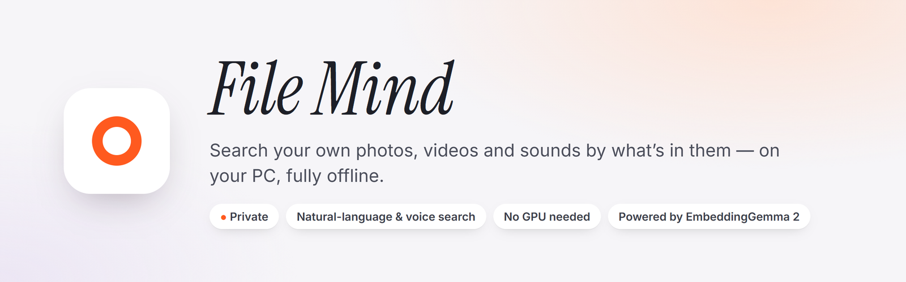
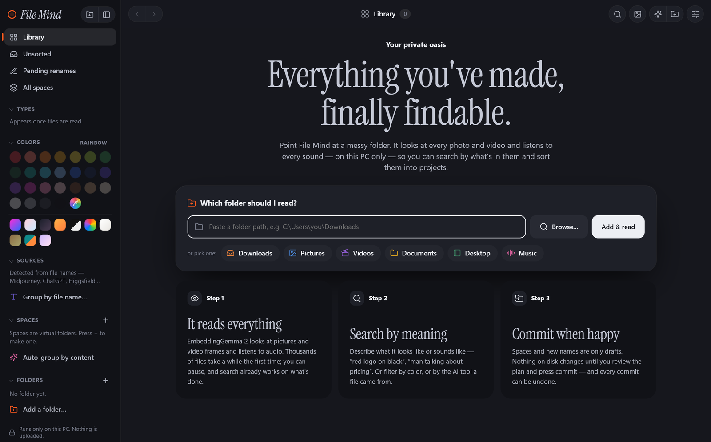
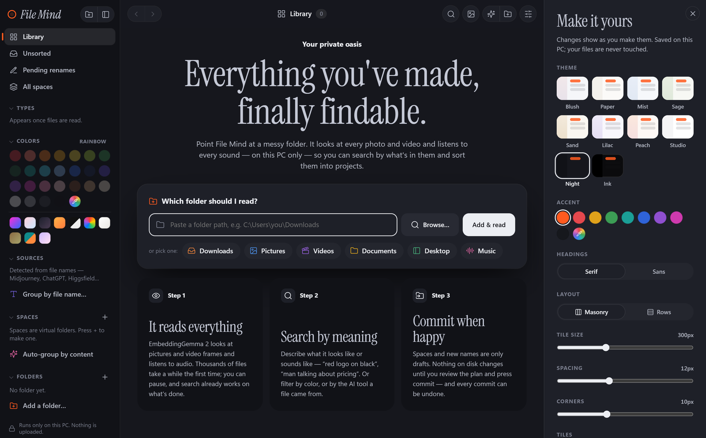
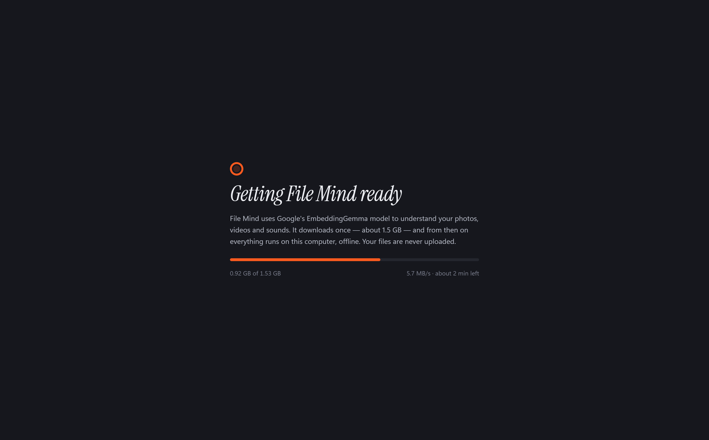

<p align="center"></p>

<p align="center">
  <a href="https://github.com/tanzim5/filemind/releases/latest"><b>⬇ Download for Windows</b></a> ·
  <a href="#what-it-does">What it does</a> ·
  <a href="#privacy">Privacy</a> ·
  <a href="#run-from-source-macos-linux-windows">macOS &amp; Linux</a>
</p>

---

File Mind reads a folder on your PC — Downloads, Pictures, a project drive — and lets you find anything in it
by describing it. It understands **what is in** your photos, videos and sounds using Google's
[EmbeddingGemma 2](https://huggingface.co/google/embeddinggemma-2), a multimodal AI model that runs entirely on
your own computer. No account, no cloud, no uploads.


## What it does

| | |
|---|---|
| 🔎 **Search in plain language** | "videos of a man running without text", "photos from Midjourney", "red logo on black". Stack several searches as tags. |
| 🎙️ **Search by voice** | Click the mic and describe it. The recording itself is understood by the model — no speech-to-text, nothing sent anywhere. |
| 🖼️ **Photos, videos and sounds** | Looks at images and video frames, listens to audio. Also filter by colour, by type, or by the AI tool a file came from. |
| 🏷️ **Tags and colour palettes** | Every file gets automatic tags and its main colours. Click any of them to find more like it. |
| ✨ **More like this** | Open a file and keep following similar ones, endlessly. |
| 🗂️ **Spaces and renames** | Group files into spaces and draft clearer file names. Nothing on disk changes until you review and commit — and every commit can be undone. |
| 🌗 **Make it yours** | Ten themes including dark Night and Ink, accent colours, masonry or rows, tile size. |

<p align="center"> </p>

## Download (Windows)

1. Download one zip from the [latest release](https://github.com/tanzim5/filemind/releases/latest):

   | Download | Pick it if | First launch downloads |
   |---|---|---|
   | **`FileMind-Windows-portable.zip`** | You're not sure. Works on every PC. | the AI model (~1.5 GB) |
   | **`FileMind-Windows-NVIDIA.zip`** | You have an NVIDIA graphics card (GTX 16-series, RTX 20-series or newer) with an up-to-date driver. Reads your library several times faster. | the AI model (~1.5 GB) + GPU support (~2.8 GB) |

2. Unzip it anywhere (Desktop, a USB stick…).
3. Double-click **`FileMind.exe`**.

Nothing to install: Python, ffmpeg and everything else are inside the folder. The first launch downloads the
rest once into that same folder; after that File Mind works fully offline.
To remove File Mind, delete the folder. (If the NVIDIA version can't use your card, it quietly runs on the CPU instead.)

<p align="center"></p>

**Requirements:** Windows 10 or 11 (64-bit) and about 8 GB of RAM. No graphics card needed.
Searching is instant. Reading a new library is a one-time job of a few seconds per photo (more for videos);
you can keep using File Mind while it works, and it picks up where it left off if you close it.

Windows may show "Windows protected your PC" the first time, because the app isn't code-signed:
click **More info → Run anyway**.

On macOS or Linux? [Run it from source](#run-from-source-macos-linux-windows) — one command.

## Privacy

- Everything runs on your computer. Your files, the index and every search stay there.
- The only network use is the one-time model download from Hugging Face.
- File Mind only **reads** your folders. Renames and moves happen only when you press commit, and can be undone.
- The index lives in a `data` folder next to the app. Delete it to forget everything.

## Run from source (macOS, Linux, Windows)

Any computer with Python can run File Mind straight from this repository. It's the same app, opening in
its own window or in your browser.

**You need**

- **Python 3.10 or newer** ([python.org](https://www.python.org/downloads/); on Linux, your distribution's `python3`).
- **ffmpeg**, for videos, sounds and voice search (photos work without it):

  | System | Install ffmpeg |
  |---|---|
  | macOS | `brew install ffmpeg` ([Homebrew](https://brew.sh)) |
  | Debian / Ubuntu / Mint | `sudo apt install ffmpeg python3-venv` |
  | Fedora | `sudo dnf install ffmpeg` (from [RPM Fusion](https://rpmfusion.org/Configuration)) |
  | Arch | `sudo pacman -S ffmpeg` |
  | Windows | `winget install Gyan.FFmpeg` |

- About **8 GB of RAM** and **6 GB of disk** (Python packages plus the 1.5 GB model).

**macOS and Linux** — one command sets everything up on the first run and starts File Mind:

```bash
git clone https://github.com/tanzim5/filemind.git
cd filemind
./run.sh
```

**Windows**

```bat
git clone https://github.com/tanzim5/filemind.git
cd filemind
run.bat
```

The first run creates a private Python environment in `.venv` and installs the packages (a few minutes).
Then File Mind opens and downloads the AI model once. Later runs start in seconds; just run `./run.sh` or
`run.bat` again. Add `--browser` to use your web browser instead of the app window. On Linux it always
opens in your browser.

<details>
<summary><b>Manual setup</b> (if you prefer to do each step yourself)</summary>

```bash
python3 -m venv .venv
source .venv/bin/activate              # Windows: .venv\Scripts\activate
# Linux without an NVIDIA GPU: install the much smaller CPU-only PyTorch first
pip install torch torchvision --index-url https://download.pytorch.org/whl/cpu
pip install -r requirements.txt
python filemind.py                     # or: python -m uvicorn app.main:app --port 8765
```

To put the model somewhere else, set `FILEMIND_MODELS`; to keep the index somewhere else, set `FILEMIND_DATA`.
You can also place the model files in `models/embeddinggemma-2/` yourself instead of letting the app download them.
</details>

**Speed.** With an NVIDIA GPU (and CUDA PyTorch), indexing is much faster. Everything else runs on the CPU,
including Apple Silicon Macs: search is instant, and reading a new library takes a few seconds per photo.

**Notes for Linux.** "Browse…" uses `zenity` or `kdialog` if one is installed; otherwise paste the folder path.
"Show in folder" opens your file manager.

To build the portable Windows zip yourself, see `packaging/build_windows.py`. GitHub Actions builds it
automatically for every `v*` tag.

## Licence

The EmbeddingGemma 2 weights are Apache-2.0. The Windows build bundles [FFmpeg](https://ffmpeg.org) (LGPL/GPL).
Interface fonts: Inter and Instrument Serif (SIL OFL).
