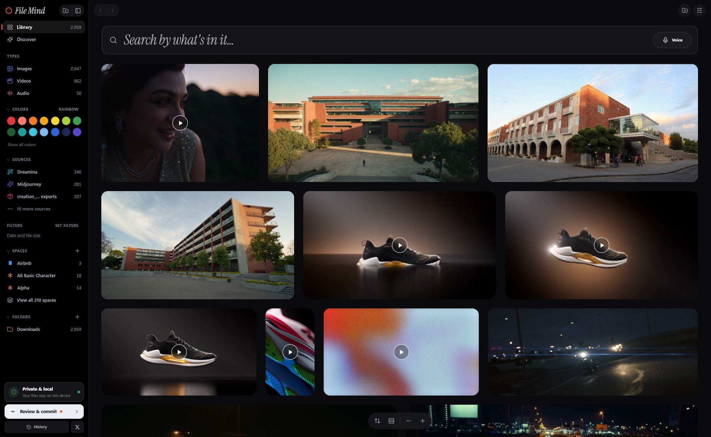
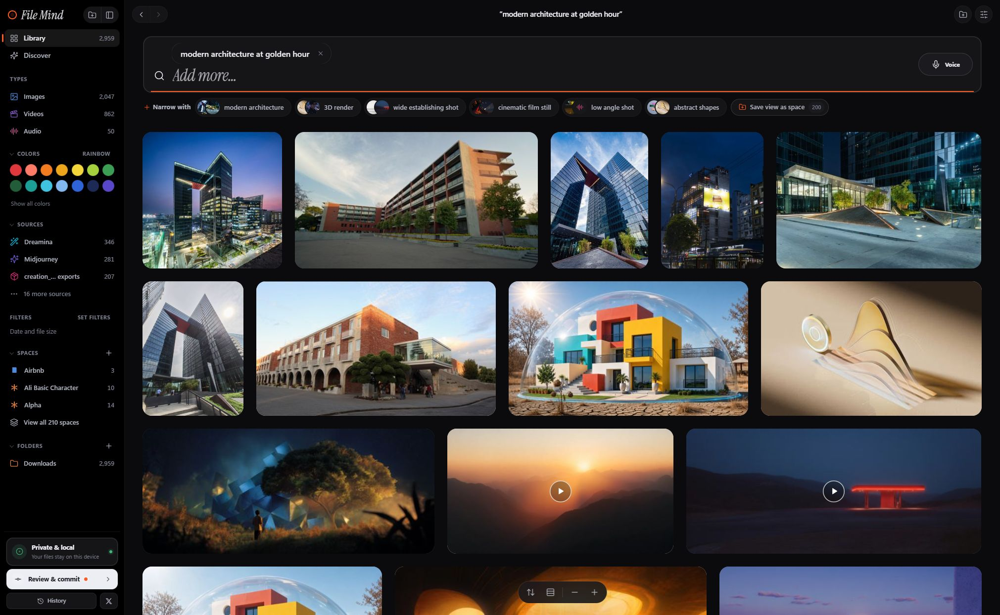
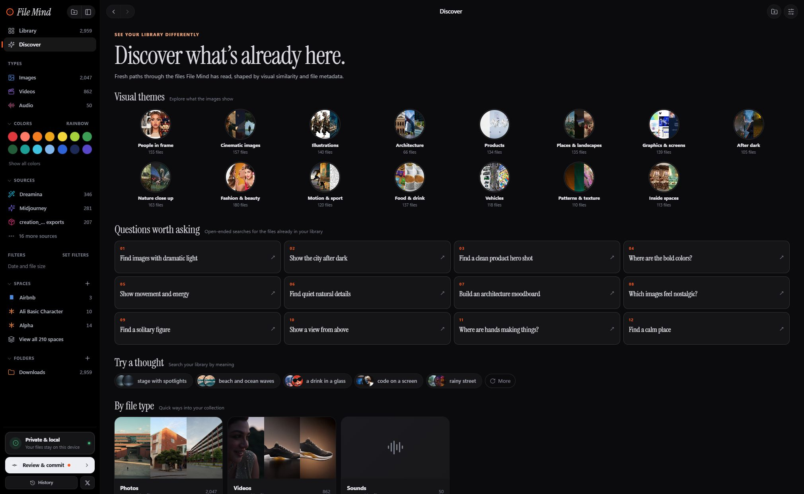
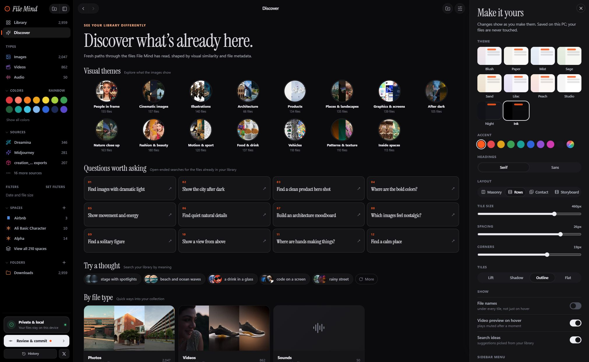

<p align="center"></p>

<h3 align="center">Find any photo, video or sound by describing it.<br>Runs entirely on your computer. No account, no cloud, no uploads.</h3>

<p align="center">
  <a href="https://github.com/tanzim5/filemind/releases/latest"></a>
  
  
  <a href="https://github.com/tanzim5/filemind/stargazers"></a>
</p>

<p align="center">
  <a href="https://github.com/tanzim5/filemind/releases/latest"><b>⬇ Download</b></a> &nbsp;·&nbsp;
  <a href="#features">Features</a> &nbsp;·&nbsp;
  <a href="#get-started">Get started</a> &nbsp;·&nbsp;
  <a href="#privacy">Privacy</a> &nbsp;·&nbsp;
  <a href="#run-from-source">Run from source</a> &nbsp;·&nbsp;
  <a href="https://x.com/tanzim31">@tanzim31</a>
</p>

<p align="center"></p>

File Mind reads a folder — Downloads, Pictures, a project drive — and understands **what is in** your photos, videos
and sounds using Google's [EmbeddingGemma 2](https://huggingface.co/google/embeddinggemma-2), a multimodal AI model
that runs on your own machine. Type what you remember ("red logo on black", "a man running at night") and it finds it.

## Features

### 🔎 Find anything
- **Search in plain language.** Stack several searches as tags to narrow down.
- **Search by voice.** The recording itself is understood by the model: no speech-to-text, nothing sent anywhere.
- **Search with a reference.** Open any image, video or audio file and choose *Search with this file*, optionally adding words.
- **Find by details.** "4K videos of motorcycles", "vertical clips under 30 seconds", "images larger than 20 MB": media details become exact filters, the rest searches by meaning.
- **Find moments.** Search inside videos and sounds and open the result at the matching time.
- **More like this.** Keep following similar files, endlessly.
- **Automatic tags and colours** on every file. Filter by colour, type, source tool, date or size.

### 🧭 Explore your library
- **Discover** visual themes (architecture, products, illustrations…) or start from a suggested question.
- **Spaces.** Group files into collections. *Live* spaces keep matching files added later; *snapshots* stay fixed. **Auto-group** suggests named collections for you to review.
- **Review duplicates**: byte-identical copies and visually similar matches. Nothing is deleted for you.

### 🖱️ Work with your files
- **Drag originals into other apps** (Windows desktop): Photoshop, After Effects, Explorer and more. Drag a tile, the viewer's image or video, or the **Drag file** handle. Select several tiles to drag them together.
- **Copy a video frame** as a PNG straight from the viewer.
- **Audio playback and transcripts**: scrub a waveform, then transcribe speech on your device in the detected language.
- **File actions**: copy or move the original, or send it to the system Trash. Copy and move never overwrite.
- **Preview renames** before anything on disk changes; commits can be undone.

### 🎨 Make it yours
- Ten themes (including dark **Night** and **Ink**), accent colours, four gallery layouts (masonry, rows, contact sheet, storyboard), tile size and a sidebar you can reorder or hide.
- Optionally keep File Mind running after you close the window, or start it quietly at login. Both are off by default.

<p align="center"> </p>
<p align="center"></p>

## Get started

Nothing to install: Python, ffmpeg and everything else are inside the download. The first launch fetches the AI model once; after that File Mind works fully offline.

| Your computer | Download | First launch also downloads |
|---|---|---|
| **Windows**, any PC | `FileMind-Windows-portable.zip` | AI model (~1.5 GB) |
| **Windows** with an NVIDIA card (GTX 16 / RTX 20 series or newer) | `FileMind-Windows-NVIDIA.zip`: several times faster indexing | AI model (~1.5 GB) + GPU support (~2.8 GB) |
| **Mac**, Apple Silicon (M1+, macOS 14+) | `FileMind-macOS-arm64.zip`: runs on the GPU through [MLX](https://github.com/ml-explore/mlx) | AI model (~1.1 GB) |

➡ Get them from the **[latest release](https://github.com/tanzim5/filemind/releases/latest)**.

<details>
<summary><b>Windows steps</b></summary>

1. Unzip anywhere (Desktop, a USB stick…) and double-click **`FileMind.exe`**.
2. Windows may show "Windows protected your PC" because the app isn't code-signed: click **More info → Run anyway**.
3. While it reads your files, the banner shows what it runs on (for example *on NVIDIA GeForce RTX 3060 (CUDA)* or *on CPU*). To watch the card work, open Task Manager → Performance → your NVIDIA GPU and switch a graph from *3D* to *Cuda*.

**Requirements:** Windows 10/11 (64-bit), about 8 GB RAM. No graphics card needed. Searching is instant; reading a new library is a one-time job of a few seconds per photo (more for videos), you can keep using the app meanwhile, and it resumes where it left off.

**Uninstall:** turn off *Start at login* in Customize, close the app, delete the folder. If the NVIDIA version can't use your card, it quietly runs on the CPU.

<p align="center"></p>
</details>

<details>
<summary><b>Mac steps</b></summary>

1. Unzip, drag **`FileMind.app`** into Applications and open it.
2. The app isn't notarized by Apple, so macOS first says it can't verify it. Open **System Settings → Privacy & Security** and click **Open Anyway** (or run once: `xattr -dr com.apple.quarantine /Applications/FileMind.app`).

The index and model live in `~/Library/Application Support/File Mind`; delete that folder to forget everything. *Start at login* adds a per-user LaunchAgent: turn it off before moving or deleting the app. Intel Macs aren't supported; on Linux, [run from source](#run-from-source).
</details>

## Privacy

- Everything runs on your computer. Your files, the index and every search stay there.
- The only network use is downloading models from Hugging Face when needed. The speech model (~148 MB) downloads only if you choose **Transcribe audio**.
- Indexing only reads your folders. Staged renames and moves happen when you press commit and can be undone. Right-click Copy, Move and Move to Trash act immediately; deletion uses the system Trash.
- The index lives in a `data` folder next to the app. Delete it to forget everything.

## Run from source

Any computer with Python can run File Mind from this repository: the same app, in its own window or your browser.

**You need:** Python 3.10–3.13 (**3.12 recommended**; 3.14 is too new for some AI libraries), about 8 GB RAM and 6 GB disk, and **ffmpeg** for videos, sounds and voice search. On a Mac: Apple Silicon and macOS 14+.

| System | Install ffmpeg |
|---|---|
| macOS | `brew install ffmpeg` |
| Debian / Ubuntu / Mint | `sudo apt install ffmpeg python3-venv` |
| Fedora | `sudo dnf install ffmpeg` ([RPM Fusion](https://rpmfusion.org/Configuration)) |
| Arch | `sudo pacman -S ffmpeg` |
| Windows | `winget install Gyan.FFmpeg` |

```bash
git clone https://github.com/tanzim5/filemind.git
cd filemind
./run.sh          # Windows: run.bat
```

The first run creates a private `.venv`, installs packages (a few minutes), opens File Mind and downloads the model once. Later runs start in seconds. Add `--browser` to use your web browser; on Linux it always does. `./run.sh` picks Python 3.12 automatically (or set `PYTHON=python3.12`).

<details>
<summary><b>Dragging files out, audio transcription and other details</b></summary>

**Dragging files out.** For original-file drops into Photoshop, After Effects, Explorer and other desktop apps, launch the Windows desktop window with `run.bat` (without `--browser`). The destination decides which formats it accepts. The original file path is sent in the Windows file-drop format, including MP4 video. Browser mode offers a download drag where supported but can't provide a native file drop to editors such as After Effects. macOS/Linux native export isn't supported yet. **Copy frame** works in the Windows desktop viewer; elsewhere the browser may offer a download instead.

**Audio transcription.** EmbeddingGemma 2 understands audio for search without turning speech into text. The optional **Transcribe audio** action uses a separate multilingual speech model for a copyable, timestamped transcript. Its first use downloads the model; later runs are offline. Music and sound effects may have no usable transcript.

**Manual setup**

```bash
python3 -m venv .venv
source .venv/bin/activate              # Windows: .venv\Scripts\activate
# Linux without an NVIDIA GPU: install the much smaller CPU-only PyTorch first
pip install torch torchvision --index-url https://download.pytorch.org/whl/cpu
pip install -r requirements.txt
python filemind.py                     # or: python -m uvicorn app.main:app --port 8765
```

Set `FILEMIND_MODELS` to put the model elsewhere and `FILEMIND_DATA` for the index. You can also place model files in `models/embeddinggemma-2/` yourself.

**Speed.** Apple Silicon uses the GPU through MLX (installed by `./run.sh`, 1.1 GB 5-bit model). With an NVIDIA GPU and CUDA PyTorch, indexing is also much faster. Everything else runs on the CPU: search is instant, reading a new library takes a few seconds per photo. To force PyTorch on a Mac, set `FILEMIND_BACKEND=torch` (downloads the original 1.5 GB model).

**Linux.** "Browse…" uses `zenity` or `kdialog` if installed; otherwise paste the folder path. "Show in folder" opens your file manager.

**Building the apps.** See `packaging/build_windows.py` and `packaging/build_macos.py`. GitHub Actions builds three downloads (standard Windows, NVIDIA Windows, Apple Silicon Mac) for every `v*` tag, checks each archive's contents and smoke-tests the standard Windows and Mac apps. You can also run the **Release builds** workflow manually; to publish from a manual run, give it an existing `v*` tag in `release_tag`. NVIDIA first-run CUDA download and GPU use need testing on an NVIDIA PC.
</details>

## Licence

The EmbeddingGemma 2 weights are Apache-2.0. The Windows and Mac apps bundle [FFmpeg](https://ffmpeg.org) (LGPL/GPL). Interface fonts: Inter and Instrument Serif (SIL OFL).

---

<p align="center">Made with care by <b>Tanzim</b> — questions, ideas, or something you found with it?<br>
<a href="https://x.com/tanzim31"><b>Say hi on X → @tanzim31</b></a></p>
